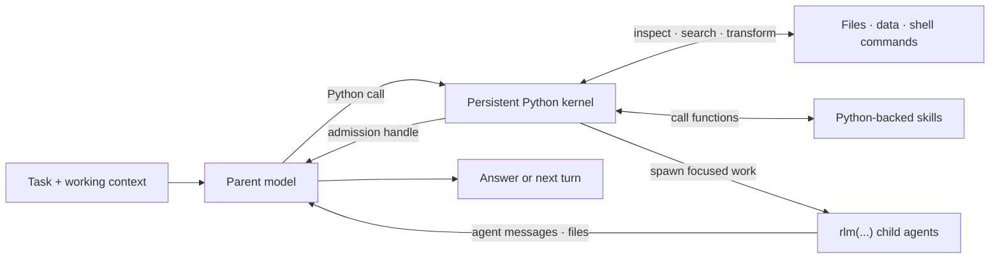

# RLM Programming Model

Base Context is built around a recursive language model (RLM) runtime: the model works inside a persistent Python control environment and composes capabilities as code. Provider calls, session persistence, child lifecycles, scheduling, and safety policy remain in the TypeScript host; the Python REPL is the model-facing programming surface.

## RLM Loop



The parent keeps its own context focused while Python holds working state and child agents receive only the context needed for their subtasks.

## Core Invariants

### 1. Execution is programmatic

The RLM execution tool is `ipython`. Native Base Context sessions also expose `prime_context` for bounded public-history recovery. Reading and editing files, running project commands, transforming results, invoking skills, and delegating work all begin from that persistent kernel instead of separate built-in tool calls.

Python state persists across tool calls. Compaction does not itself clear the live namespace, and kernel snapshots support best-effort restoration after restart. Not every object is serializable or retained. Variables, parsed results, and task handles can remain available on later turns:

```python
from pathlib import Path

config_files = list(Path(".").rglob("*.toml"))
large_files = [path for path in config_files if path.stat().st_size > 10_000]
```

Run a project's normal commands through its own environment with `bash()`:

```python
result = await bash("npm run check")
print(result.output)
```

Each `bash()` call is its own process, while Python state, `os.chdir(...)`, and `os.environ[...]` changes persist in the kernel and apply to later `bash()` calls. Base Context extensions may intentionally add custom tools, but the built-in RLM design does not require a separate model tool for every capability.

#### Pending cell control

Fast `ipython` cells return their normal result. If an admitted cell has not finished after the configured foreground wait (one second by default), the tool returns a pending execution ID without cancelling it. The cell is **not paused**: it keeps running in the same namespace and can change variables and files.

Set `foregroundWaitMs` in global or project `settings.json` to a finite nonnegative duration in milliseconds (default `1000`). `0` yields as soon as the host can return a pending result. This changes only foreground waiting after admission, not startup or execution deadlines. The generated prompt uses the same effective value. `bash()` still returns its background handle immediately.

Initial snapshot restore and runtime bootstrap each have a 30-second deadline. Startup failure waits for kernel cleanup and does not overwrite the previous usable snapshot. Kernel replacement waits for the previous kernel to stop. Failed cleanup blocks replacement. Snapshot writes stay disabled until initial restore and bootstrap succeed, and while a replacement kernel still needs restore or bootstrap. A structural restore failure during protocol repair stops that kernel and preserves the saved snapshot; it does not continue with an empty namespace. Per-variable restore failures still permit the other variables to load.

Persistent sessions retain large final output and show a bounded text preview: 4 KiB for successful output without stderr or an error, and 8 KiB for diagnostics. The preview budget uses UTF-8 bytes and includes its retention notice. Full captured text remains recoverable; partial capture is marked. Native selected recovery bodies, attachments, and execution ownership are separate from this preview.

Use these `ipython` tool arguments, not Python code:

| Operation | Arguments |
|---|---|
| Inspect progress or collect the final result | `{"action":"status","execution_id":"<id>"}` |
| Request interruption | `{"action":"interrupt","execution_id":"<id>"}` |

Status and interrupt are handled by the host, so they do not wait for the busy Python cell. Use either `code` or an `action` with `execution_id`, never both. One cell can be outstanding. New code is rejected while it runs. After it finishes, a completion follow-up gives its ID; new code remains rejected with a result-ready notice until `status` collects the final rich result and frees the slot. End the turn when waiting for the completion follow-up. This is not a registry of completed jobs.

Interruption requests cancellation and unwinding. It is not a resumable pause or rollback, and it does not guarantee cleanup of arbitrary subprocess groups. Aborting a foreground call returns control promptly even with a long configured wait. The request can return before execution has stopped; collect the terminal result with `status`. Pending execution remains part of session completion and end-of-input handling. Yielding does not change the task deadline or restart the kernel.

### 2. Subagents are native RLM calls

The callable `rlm` object is preloaded in the kernel. Spawn a child with a direct call:

```python
handle = await rlm("Review the authentication flow for security issues", name="auth-reviewer")
print(handle.rlm_child_id, handle.name, handle.session_dir, handle.model)
```

The call returns immediately after task admission with a child handle; it never waits for or returns the child's answer. The TypeScript host creates a normal child `AgentSession` with an independent context and session directory. The child inherits the parent model, provider configuration, skills, tools, retry policy, and resource loader unless the call requests another configured model.

Spawn independent children in separate calls and end the turn instead of awaiting completion:

```python
api_review = await rlm("Review the public API", name="api-reviewer")
test_review = await rlm("Review the test coverage", name="test-reviewer")
integration_audit = await rlm("Run the slow integration audit", name="integration-audit")
```

Results arrive only through explicit `agent_message` replies or files, never as an `rlm()` return value. For substantial findings, send a short capsule and retain the detailed report:

```python
receipt = await agent_message.send_result(
    summary="Found the cause; one configuration question remains.",
    findings=report_path.read_text(),
    receiver_role="parent",
)
```

The recipient stores the full public report in its own session before receiving the capsule. The report is not added to the recipient's model context. The capsule and `receipt["resultRef"]` identify the retained source, entry and findings field. The recipient can use the existing `prime_context` read/search operations (or `rlm.prime_context` in an active kernel call) to request selected lines or search for a relevant section. The report remains available after the child runtime stops, within normal recipient-session retention and branch scope.

Capsules are child-authored conclusions, not verified facts. Put decisive contrary evidence, corrected premises, material caveats, unresolved decisions and observed artifact changes in the summary or `outcome`, not only the archived findings. Identify earlier report refs that the capsule revises or replaces. A parent should read the capsules first and retrieve relevant report sections; a newer message does not automatically replace independent findings or unresolved blockers. Keep unresolved evidence and its references in current decisions and final briefs until resolved against the user request. A narrower brief or more favorable report is not itself a resolution. Older reports remain readable.

Summaries must fit 2,000 characters. The complete encoded report uses the existing native source size limit; oversize reports refuse instead of being clipped. This operation adds no summarization-model call. Ordinary short questions and progress messages stay inline:

```python
await agent_message.send(message, receiver_role="parent")
```

The parent can follow up with a retained child:

```python
await agent_message.send(
    "Check the newly added regression test.",
    receiver_role="child",
    receiver_name=api_review.name,
)
```

#### Child handles and lifecycle

An admission handle contains `rlm_child_id`, `name`, `session_dir`, and `model`. Child usage is attributed to the parent session while remaining distinguishable in context-tree reporting. Native child usage reporting continues after passivation and rehydration. `/context` separately totals saved request receipts for the captured family; parent attribution records are not added to those totals. See [token usage and status](usage.md#token-usage-and-status) for missing-data, catalog-estimate, and goal-budget scope.

The parent-scoped child registry survives compaction, kernel restart, and parent restoration:

```python
children = await rlm.list_subagents()
for child in children:
    print(child.session_name, child.status, child.active_session_id)
```

Successfully completed daemon-backed children remain addressable while their parent session is open. For routine cleanup, receive the requested result, observe idle, and delete the child when its context is no longer needed:

```python
await rlm.delete_subagent(children[0])
```

Deleting a busy child cancels active work and can discard an unsent correction. A delivered or queued `agent_message.send` receipt does not establish that the follow-up finished. Intentional cancellation remains available; report it as cancellation, not completed work. Reports already archived in the parent remain available under the parent's normal retention and branch scope.

The default maximum recursion depth is `2`, with the root at depth `0`. The host enforces the accepted session limit. See [recursive-agent settings](settings.md#recursive-agents) for the global creation default.

### 3. Skills add programmatic capability

Base Context supports the Agent Skills markdown format and extends it with Python-backed skills. Both use `SKILL.md` for discovery, routing, and instructions. A Python-backed skill also contains a Python package that Base Context installs into the kernel environment and exposes by import name.

For example, if a skill named `release-audit` documents an async `audit` function in its `release_audit` module, the model can call:

```python
report = await release_audit.audit(repository=".", target_version="1.0.0")
```

This makes Python-backed skills a superset of instruction-only skills: they can provide guidance, scripts, references, dependencies, typed callables, and optional shell commands. They may also call `rlm(...)` themselves when a capability needs recursive delegation.

Only skill metadata is placed in the startup prompt. The agent loads the full `SKILL.md` when the task matches, then inspects and calls the documented Python API. See [Skills](skills.md) for discovery, packaging, and the built-in skill-creation workflow.

### 4. State is designed to outlive one turn

The RLM programming model assumes useful work may take many turns or continue after the terminal UI closes:

- automatic compaction summarizes older context while preserving recent messages and kernel state;
- daemon-backed workers keep active sessions running after clients detach;
- child registries and session artifacts make subagents recoverable;
- heartbeats and scheduled prompts re-enter a session later;
- persistent goals continue until the objective is complete or the user changes their state; and
- autonomous mode adds bounded continuations and optional quality gates.

See [Long-Running and Background Agents](long-running-agents.md) for these lifecycle features.

## Host Bridge

Python skills use typed host requests for capabilities whose authoritative state belongs outside the kernel. For example, the `goal`, `agent_message`, `rlm_heartbeat`, and `compact` skills call `rlm.host_request(...)`; the TypeScript host validates the request and owns the state transition.

This keeps credentials, provider execution, transcript writes, worker routing, and scheduling out of Python while retaining a programmatic model interface.

## Trust Model

The Python kernel runs model-generated Python and project commands with the worker's operating-system permissions. It is a durable control environment, not a security sandbox. Review third-party Python skills and use an external sandbox or restricted environment for untrusted repositories and instructions.

For implementation details, see [RLM Runtime Architecture](rlm-runtime.md).
